# AniFeed

将 RSS 订阅离线下载到 115 网盘。

支持批量添加 magnet, ed2k, http 链接到 115 离线任务

## 关于

基于 [Nahuimi/elevengo](https://github.com/Nahuimi/elevengo)

支持以下 RSS 源（按订阅 URL 的域名识别）：

- 蜜柑计划：`mikanani.me`、`mikanime.tv`
- Nyaa：`nyaa.si`、`sukebei.nyaa.si`
- 动漫花园：`share.dmhy.org`
- ACGNX：`share.acgnx.se`、`share.acgnx.net`、`www.acgnx.se`
- RSSHub：`rsshub.app`（从 RSS 条目的 enclosure 中读取下载链接）
- AniBT：`anibt.net`
- AnimeGarden：`animes.garden`、`api.animes.garden`
- 其他通用 RSS：任意域名，自动从 enclosure / description 提取 magnet、ed2k 或 HTTP(S) 下载链接

已添加的 RSS 任务记录保存在本地的同一目录下面的 db.sqlite 文件里

Rust 版本 [rss2pan](https://github.com/zhifengle/rss2pan) 使用的 Web API 添加离线任务。

## Web UI

这个分支在原有 CLI 的基础上内置了一套完整的 Web 控制台，**不需要 Node.js 构建，也不需要单独部署前端**，所有页面都打包进同一个二进制文件。

- 订阅管理：参考 [ani-rss](https://github.com/wushuo894/ani-rss) 的添加流程，支持 **Mikan / AniBT / AnimeGarden / 其他** 四种来源，可填写番剧 ID 自动生成 RSS，也可直接粘贴完整地址。
- 站内浏览：在页面内搜索 Mikan / AniBT / AnimeGarden，按季度和星期切换，展开字幕组与资源预览，一键填入订阅表单。
- 默认离线位置：统一设置默认 115 目录 ID 和保存路径模板（如 `番剧/${title}`），单个订阅可覆盖；目录可直接浏览 115 网盘选择，并支持新建文件夹。
- 重命名与离线后转移：可对 115 已完成离线任务按模板重命名；开启离线后转移到保存文件夹后，先离线到「默认离线文件夹」，重命名成功再移动到「默认保存文件夹」。
- TMDB 关联：设置 TmdbApi / TmdbApiKey / TmdbImage，在订阅里搜索并关联 TMDB，重命名支持 `${tmdbid}`。
- 番剧海报：订阅卡片显示海报和评分，支持从站点手动更新、本地上传覆盖和恢复自动海报。
- 规则库：内置 AB_AR_exclude_regular_expressions 的字幕组排除预设，并按简体/繁体、内封/内嵌、MP4/MKV、分辨率生成细分 filter/exclude。
- 登录 115：支持粘贴 Cookies 或扫码登录，保存后立即热重载。
- 运行订阅：单个订阅或全部订阅一键运行，实时查看每个订阅发现的新内容、以前下载过和本次提交数量。
- 自动运行：可设置间隔、启动时立即运行；支持全局排除、跳过 x.5 集、失败重试、运行后自动清理已完成任务。
- 通知：运行结束后推送纯文本摘要，支持企业微信机器人 / 通用 Webhook、推送内容选择和测试通知。
- 任务与历史：查看 115 离线任务进度、清理任务；查看本地提交历史并追踪任务 hash。
- 设置：服务端口、访问令牌、数据库路径、115 限流参数、代理、站点请求头、Mikan 镜像地址，以及保留注释的原始 `config.toml` 编辑器。

### 启动

```bash
# 编译
go build -o anifeed .

# 启动 Web UI（监听 0.0.0.0:8115，本机访问 http://127.0.0.1:8115）
./anifeed server

# 或者使用别名
./anifeed web

# 指定监听地址和端口
./anifeed server --host 0.0.0.0 --port 8115
```

首次启动时如果当前目录没有 `config.toml`，打开页面后在「设置」中填写 115 Cookies（或扫码登录）并保存，程序会自动生成 `config.toml`。旧的 `rss.json`、`node-site-config.json`、`.cookies` 会被读取并在首次保存时迁移，原文件不会被删除。

### Docker

从 Docker Hub 拉取：

```bash
docker pull huohen92/anifeed:0.02
docker run -d \
  --name anifeed \
  --restart unless-stopped \
  -p 8115:8115 \
  -v "$PWD/data:/data" \
  -e TZ=Asia/Shanghai \
  huohen92/anifeed:0.02
# 打开 http://服务器IP:8115
```

镜像地址：

```text
huohen92/anifeed:0.02
huohen92/anifeed:latest
```

当前镜像为 `linux/amd64`，基于 scratch + 静态 musl 二进制，体积约 8 MB。

也可以从源码构建：

```bash
docker compose up -d --build
```

数据（`config.toml`、`.cookies`、`db.sqlite`）保存在 `./data` 目录。

### 截图

| 概览 | 订阅管理 |
| --- | --- |
| 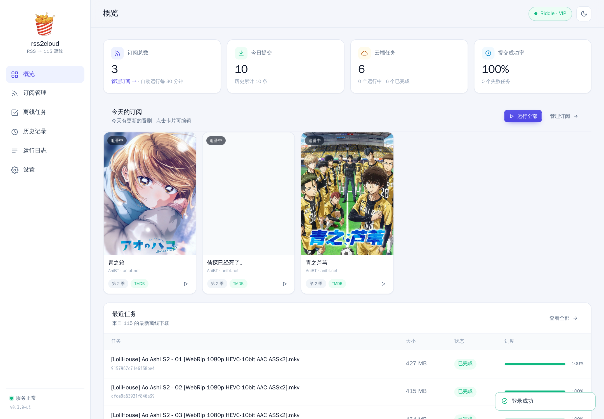 | 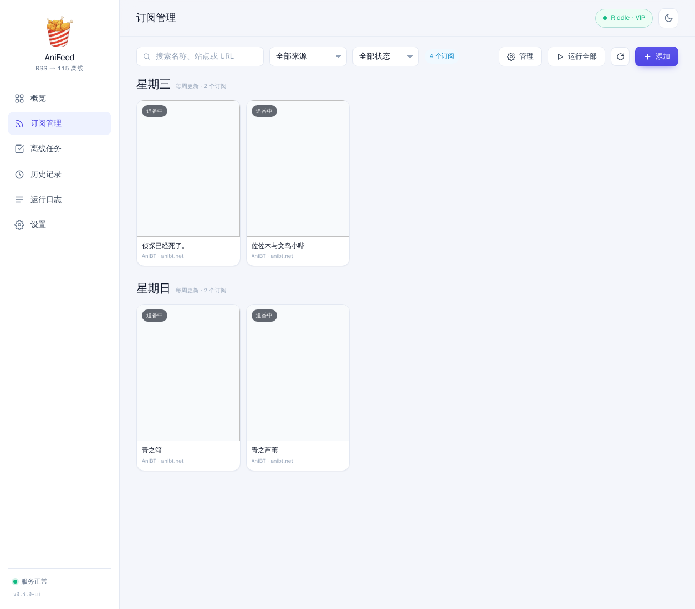 |

| 默认离线设置 | 历史记录 |
| --- | --- |
| 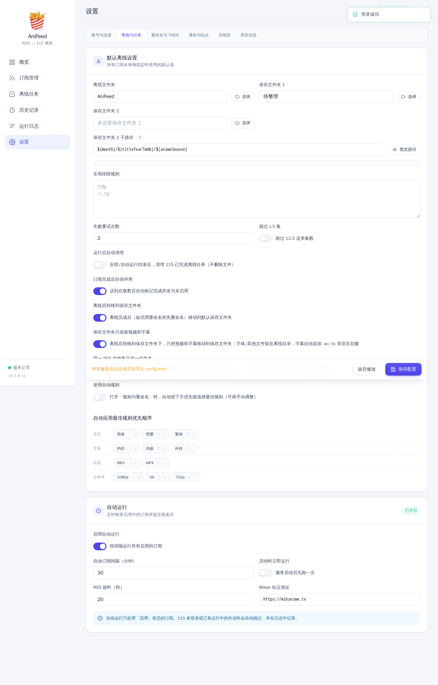 | 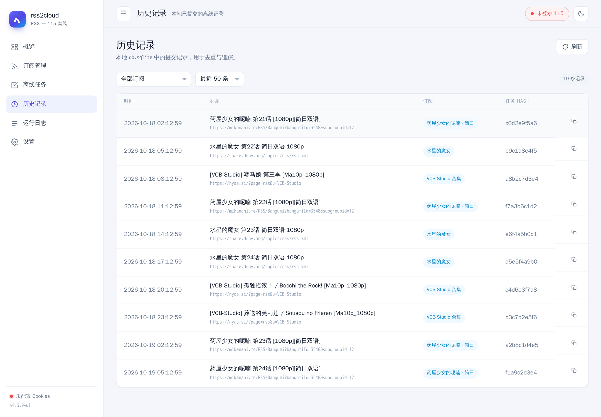 |

站内浏览与 115 目录选择：

| 浏览订阅 | 选择 115 目录 |
| --- | --- |
| 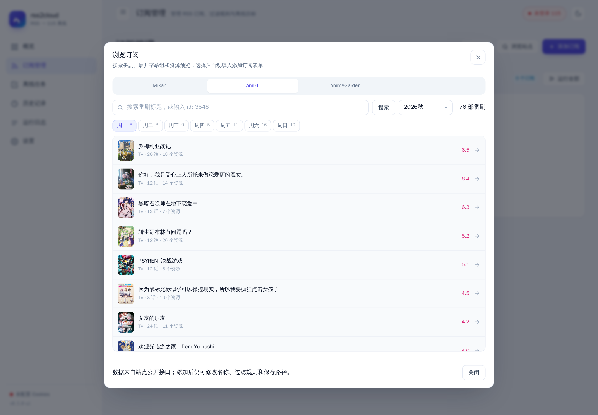 | 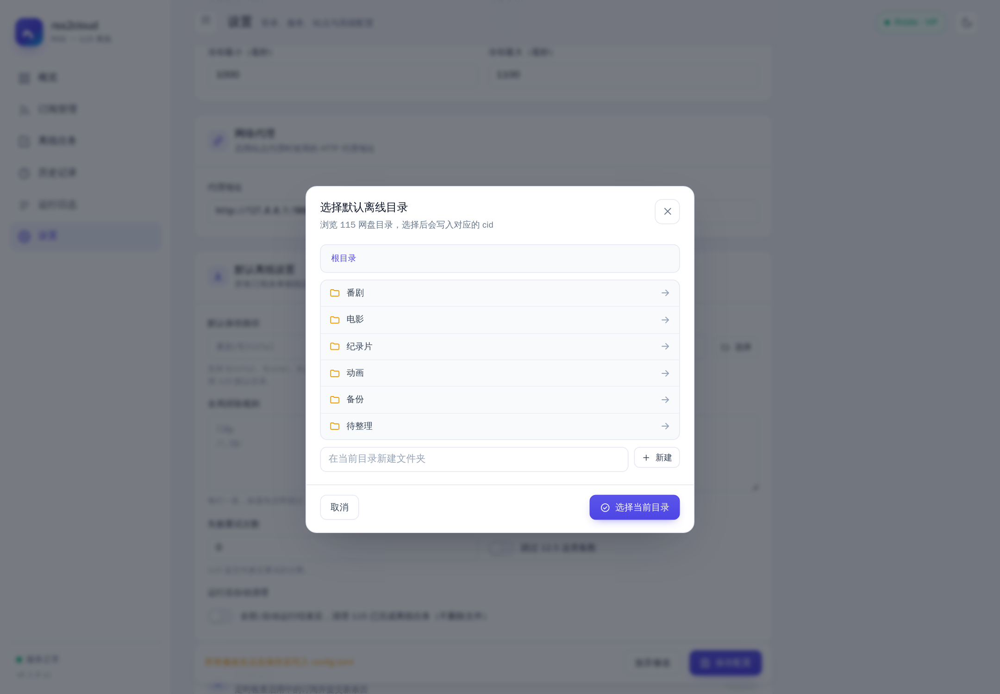 |

移动端与订阅编辑弹窗：

| 移动端 | 添加订阅 |
| --- | --- |
| 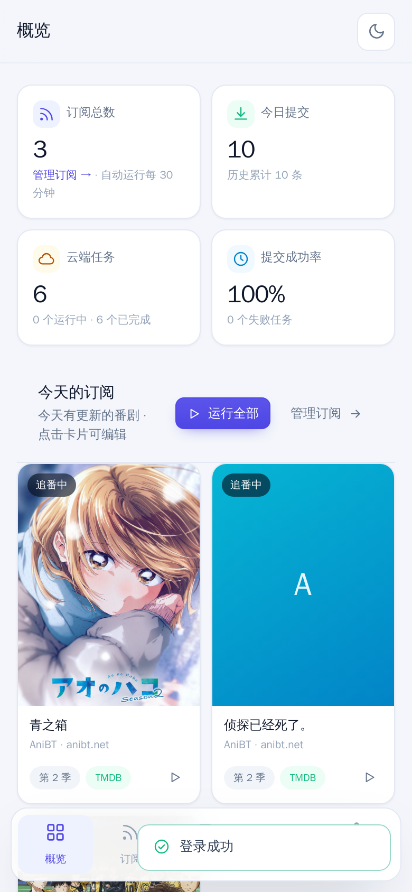 | 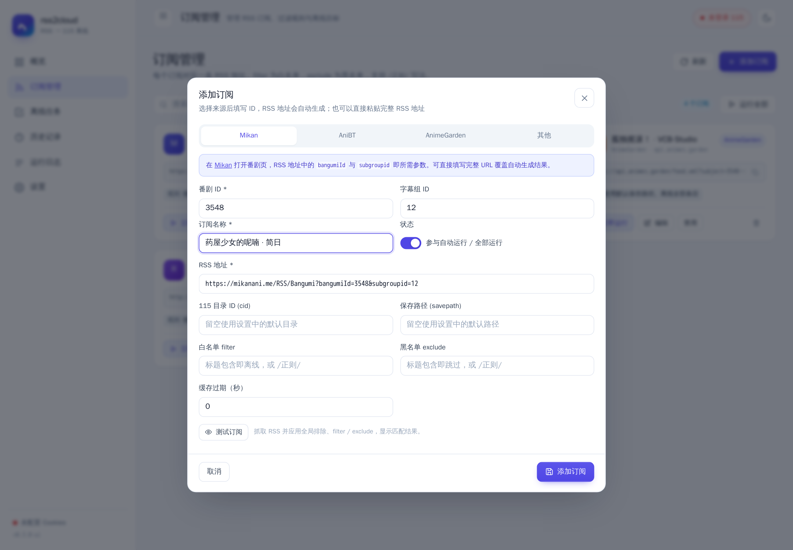 |

### 保存文件夹 1 / 2

设置 → 离线与任务 → 默认离线设置：

- 保存文件夹 1：所有视频放到同一个目录
- 保存文件夹 2：作为根目录，按子路径模板为每部番剧建文件夹
- 保存文件夹 2 子路径支持 `${title}`、`${titleYearTmdb}`（如 `冰之城墙 (2026) {tmdb-283428}`）、`${animeSeason}`（如 `Season 2`）、`${seasonNumber}`、`${tmdbid}`、`${site}`、`${year}`、`${month}`、`${day}`、`${season}`

订阅编辑里的「保存文件夹来源」可以选择：

- 全局保存文件夹 1
- 全局保存文件夹 2
- 自定义文件夹

选择自定义文件夹后，还可以选择自定义模式：

- 保存文件夹 1：所有视频直接放到自定义文件夹
- 保存文件夹 2 子路径：自定义文件夹作为根目录，按子路径分文件夹

订阅级设置优先于全局设置。「默认保存路径」已移除。

### 重命名与离线后转移

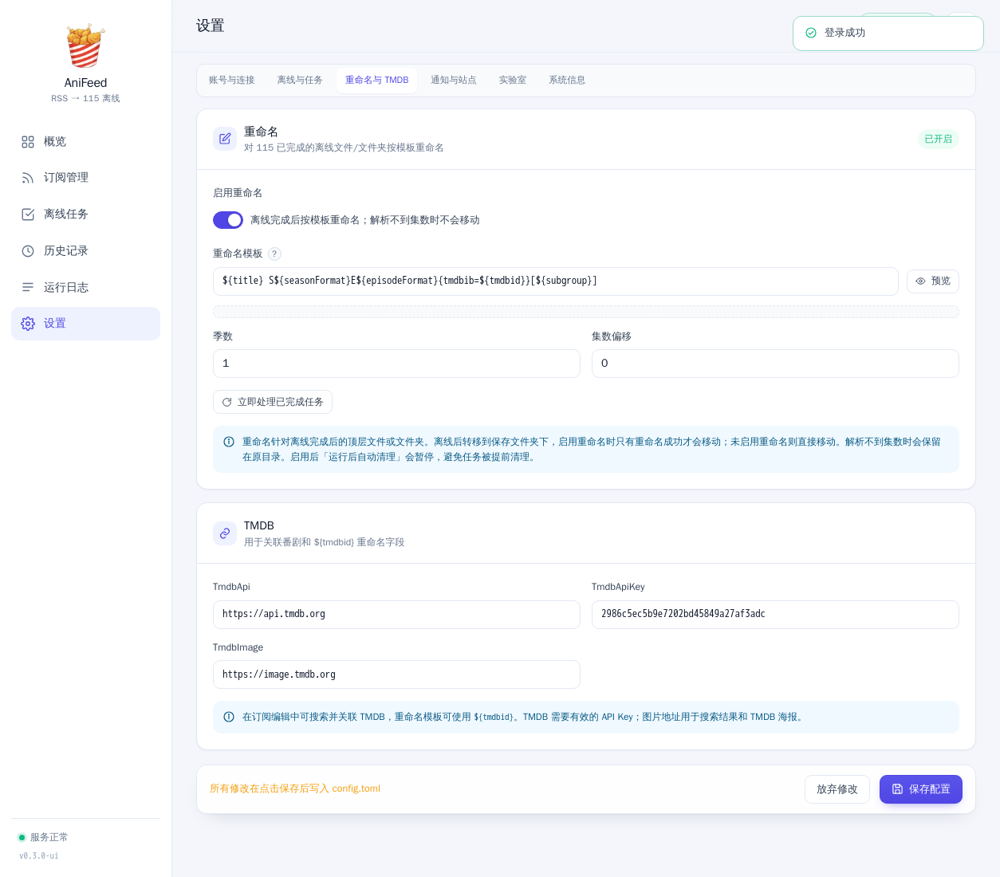

在「设置 → 重命名」中启用：

- filter/exclude 支持多行：filter 多行为 AND，exclude 多行为 OR
- 支持 ani-rss 风格 `{{字幕组}}:正则`，例如：

```text
{{今晚月色真美}}:1080[Pp]
{{今晚月色真美}}:简
{{今晚月色真美}}:日
{{今晚月色真美}}:内嵌
{{今晚月色真美}}:avc|Avc|AVC
```

- **模板**默认：`[${subgroup}] ${title} S${seasonFormat}E${episodeFormat}`
- 支持变量：`${title}`、`${subgroup}`、`${season}`、`${seasonFormat}`、`${episode}`、`${episodeFormat}`、`${itemTitle}`、`${resolution}`、`${tmdbid}`
- 模板旁边的 `?` 会弹出完整变量说明和示例
- TMDB：在「设置 → TMDB」填写 TmdbApi / TmdbApiKey / TmdbImage；订阅编辑里可搜索关联 TMDB，季数和 TMDB ID 可单独覆盖
- 可设置全局季数和集数偏移；每个订阅还可以单独设置「重命名季数」和「集数偏移」覆盖全局
- 订阅季数为 0 时自动从订阅名/BT 标题识别季数（第二季、Season 2、S2 等）
- 设置中可调整「自动应用最佳规则」的语言、字幕、容器、分辨率优先顺序
- 「每集只下载一个版本」默认关闭：默认只识别并记录集数，不实际跳过；开启后才按评分只提交最高分的一个
- 启用「离线后转移到保存文件夹」后，115 先下载到「默认离线文件夹」；任务完成后，如启用重命名则重命名成功再移动到「默认保存文件夹」，未启用重命名则直接移动
- 启用重命名且解析不到集数时不会移动，任务保留在离线文件夹并记录错误
- 启用重命名/离线后转移后，`运行后自动清理` 会暂停，避免已完成任务在重命名前被清理；可手动点击「立即处理已完成任务」

```toml
[offline]
default_cid = "离线文件夹ID"
dual_folder = true
final_cid = "保存文件夹ID"

[rename]
enabled = true
template = "[${subgroup}] ${title} S${seasonFormat}E${episodeFormat}"
season = 1
offset = 0
```

> 离线任务的完成检测由后台每 20 秒轮询一次；任务较多时需要等待。重命名只处理启用该功能后提交的订阅任务。

### 规则库 / 细分匹配

点击「添加订阅」会先弹出匹配偏好面板；编辑订阅时也可以在表单里点击「规则库 / 细分匹配」：

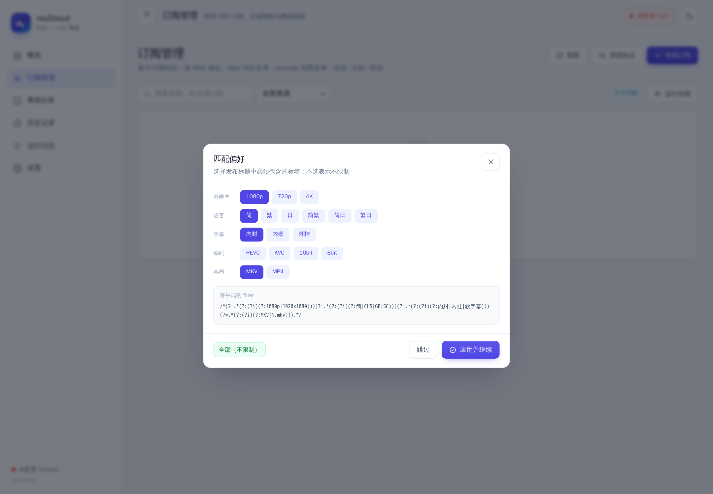


- 语言：简体 / 繁体 / 简繁双语
- 字幕：内封 / 内嵌 / 外挂
- 容器：MKV / MP4
- 分辨率：1080p / 720p / 4K
- 字幕组排除预设：桜都、喵萌、北宇治、MingY、拨雪寻春、漫猫、Up to 21°C、悠哈璃羽

选择偏好后自动生成：

- `filter`：必须同时包含所选属性（正则 lookahead）
- `exclude`：排除同类其他属性及选中的字幕组规则

规则库字幕组预设来源：[AB_AR_exclude_regular_expressions](https://github.com/jacksen168sub/AB_AR_exclude_regular_expressions)。

### 重命名预览

在订阅编辑弹窗中点击「规则与重命名」，选择细分规则后会读取当前 RSS 内容，并在下方直接显示匹配条目、按 BT 标题生成的新名称和「将下载 / 跳过」。解析不到集数的条目会标记为「无法解析」，缺失集数会显示在顶部；预览不会下载或修改文件。

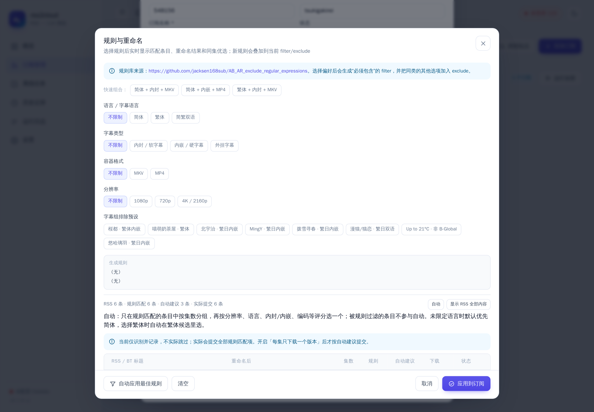

### 逐条预览

订阅编辑里的「预览」按钮按 ani-rss 风格显示每个匹配条目：

- 是否下载：逐条切换，支持全选 / 全不选、批量允许 / 禁止
- 已下载：来自本地历史记录
- 主RSS：当前订阅
- 字幕组、标题、重命名结果
- 删除已下载：强制删除选中条目的本地下载历史与后台处理记录；可勾选「同时删除云盘文件与离线记录」

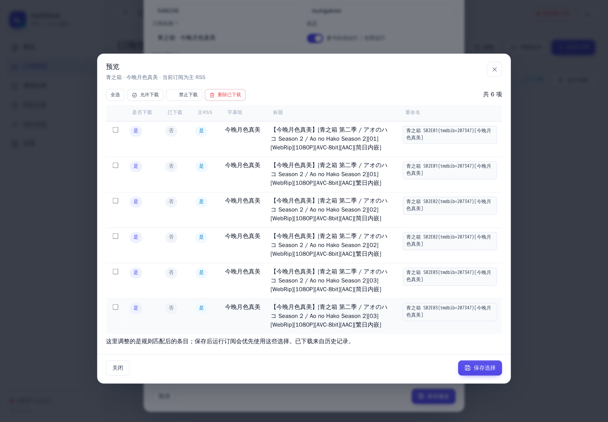

### TMDB 关联与海报管理

- 「设置 → TMDB」填写 `TmdbApi`、`TmdbApiKey`、`TmdbImage`
- 订阅编辑中支持「自动」匹配 TMDB，也可以点击「搜索」手动选择；结果写入 `tmdb_id` / `tmdb_type`
- 重命名模板可使用 `${tmdbid}`；未关联时替换为空
- 点击订阅海报打开管理弹窗，可「从站点更新」「上传本地图片」或「恢复自动」
- 本地上传文件保存在 `config.toml` 同级的 `posters/` 目录，最大 5MB

### 订阅来源

| 来源 | 需要填写 | 自动生成 |
| --- | --- | --- |
| Mikan | 番剧 ID、字幕组 ID（可选） | `https://mikanani.me/RSS/Bangumi?bangumiId=...&subgroupid=...` |
| AniBT | Bangumi ID、groupSlug（可选） | `https://anibt.net/rss/anime.xml?bgmId=...&groupSlug=...` |
| AnimeGarden | 番剧 ID（subject）、字幕组名称（可选） | `https://api.animes.garden/feed.xml?subject=...&fansub=...` |
| 其他 | 任意 RSS 地址 | 手动填写，支持 magnet/ed2k/HTTP(S) |

### 站内浏览订阅

在「订阅管理」点击「浏览站点」，或添加订阅弹窗里的「在 X 中浏览」：

- **Mikan**：搜索番剧标题或输入 `id: 3548`，解析番剧与字幕组列表。
- **AniBT**：按季度/星期浏览，展开字幕组和资源预览。
- **AnimeGarden**：按星期浏览当前番剧，展开字幕组与资源。
- 点击字幕组的「添加订阅」会自动填入番剧名称（不包含字幕组）、来源和 RSS 地址，仍可继续修改过滤规则、保存路径和 cid。
- 订阅管理页不再显示 RSS 链接，只保留「复制 RSS 地址」图标；链接在编辑弹窗里查看。订阅卡片改为与首页一致的紧凑海报卡片，并按番剧更新星期分组；更新星期自动通过 TMDB 已播出集的 air_date 推导；无 TMDB 时按最近下载日期兜底。
- 订阅卡片显示番剧海报；点击海报可管理海报，预览重命名在编辑弹窗内。
- 已订阅的番剧会显示「已订阅」标记。


> 浏览数据来自站点公开接口，需要服务器能访问对应站点。`mikanani.me` 不可达时，浏览会自动尝试 `https://mikanime.tv` 镜像；也可以在「设置 → 自动运行 → Mikan 站点地址」中手动指定，浏览和 RSS 生成都会使用该地址。截图中的订阅、历史记录和目录为演示数据。

> 安全提示：Web UI 可以读写 115 凭据。默认监听 `0.0.0.0` 时请只在可信内网使用；需要暴露到外网时，请在「设置 → 服务与访问」中配置 `server.access_token`，或使用反向代理加认证。

详细说明见 [Web UI 使用文档](./docs/web-ui.md)。

## 文档

- [Web UI 使用文档](./docs/web-ui.md)：页面功能、访问令牌、热重载与常见问题。
- [配置文件说明](./docs/config-files.md)：推荐使用统一的 `config.toml`，也说明了传统 `rss.json`、`node-site-config.json`、`.cookies` 的兼容读取规则。
- [Linux systemd 安装](./docs/linux-systemd-install.md)：安装 release 二进制并注册为 systemd 服务，支持安装、更新、卸载和清理数据。

## 用法

推荐使用统一的 `config.toml` 配置认证、RSS 订阅和站点选项。配置文件可放在当前工作目录或 `~/.config/anifeed/` 下，程序优先读取当前工作目录的配置。完整示例和字段说明见 [配置文件说明](./docs/config-files.md)。

原有的 `rss.json` 和 `node-site-config.json` 仍兼容，无需立即迁移。配置完成后，在命令行运行 `anifeed`：

```bash
# 查看帮助
anifeed -h
# 直接运行，按配置的 RSS 订阅依次添加离线任务
anifeed
# 使用二维码登录
anifeed -q
# 使用cookies
anifeed --cookies "yourcookies"

# 指定 rss URL 离线下载
# 如果 RSS 配置中存在该 URL，则使用对应的订阅配置；否则离线到 115 的默认目录
anifeed -u "https://mikanani.me/RSS/Bangumi?bangumiId=2739&subgroupid=12"
# --no-cache 跳过检查 db.sqlite 里面缓存的
anifeed --no-cache -u "https://mikanani.me/RSS/Bangumi?bangumiId=2739&subgroupid=12"
# --clear-task-type 清除离线任务。 1: 已完成的  2: 所有任务 3: 失败任务 4: 运行的任务 5: 完成并删除的任务 6: 所有的任务
# 清除115任务列表里面已经完成的任务
anifeed --clear-task-type 1

# 查看 magnet 子命令帮助
anifeed magnet -h
anifeed magnet --link "magnet:?xt=urn:btih:12345" --cid "12345" --savepath "文件夹名称"
# 离线包含 magnet 的 txt 文件; 按行分割
anifeed magnet --txt magnet.txt --cid "12345" --savepath "文件夹名称"
# savepath 支持多级路径
anifeed magnet --link "magnet:?xt=urn:btih:12345" --cid "12345" --savepath "文件夹名称/子文件夹名称"
```

### 离线任务与历史记录

`anifeed task` 查看 115 当前的离线下载任务，`anifeed history` 查看本地 `db.sqlite` 里已提交的离线记录。

```bash
# 查看 task 子命令帮助
anifeed task -h
# 列出最近的离线任务（默认 50 条）
anifeed task
# 只看运行中的任务；状态可选 all|done|failed|running
anifeed task --status running
# 限制条数
anifeed task -n 10
# 显示完整任务名，不压缩 [标签] 和不截断
anifeed task --full-name

# 查看 history 子命令帮助
anifeed history -h
# 列出最近提交的离线记录（默认 20 条，最新在前）
anifeed history
# 按 RSS 订阅配置名过滤
anifeed history --name "VCB-Studio"
# 限制条数
anifeed history -n 50
# 显示完整标题，不截断
anifeed history --full-name
```

说明：

- `task` 直接查询 115 远端任务列表，输出 NAME、SIZE、STATUS、PERCENT 列。默认会压缩任务名里的字幕组、分辨率等标签并截断到固定宽度，`--full-name` 显示原始名称。
- `history` 查询本地 `rss_items` 表，输出 ID、TITLE、FEED、CREATED、HASH 列。`--name` 按订阅配置名过滤，`HASH` 是 115 离线任务返回的任务哈希。

### 文件管理命令

`anifeed fs` 提供 115 网盘文件管理命令，可用于搜索整理和目录扁平化。

```bash
# 查看 fs 子命令帮助
anifeed fs -h

# 搜索 /anime 下名称包含 episode 的文件，并移动到 /anime/inbox
anifeed fs search-mv /anime episode /anime/inbox

# 只移动匹配关键字的 mkv 视频文件
anifeed fs search-mv /anime episode /archive --type 4 --ext mkv

# 将 /video_folder 的后代文件提升到目录本身
anifeed fs flatten /video_folder

# 只查看 flatten 计划，不执行实际移动
anifeed fs flatten /video_folder --dry-run
```

### fs shell

`anifeed fs shell` 提供一个交互式文件管理会话，适合连续执行 `ls`、`cd`、`mv`、`search-mv`、`flatten` 这类操作。

```bash
# 启动交互式 shell
anifeed fs shell

# 调整目录缓存时间
anifeed fs --list-cache-ttl 5s shell

# 关闭目录缓存
anifeed fs --list-cache-ttl 0 shell
```

进入 shell 后可用的常见命令：

```text
pwd
ls
cd /anime
stat episode.mkv
mkdir inbox
mv episode.mkv inbox
search-mv /anime episode /archive
flatten /video_folder
rm /anime/old-file.txt
refresh
exit
```

交互示例：

```text
$ anifeed fs shell
115:/>
ls
d  123456789012  anime
d  223456789012  archive
cd /anime
search-mv /anime episode /archive
moved: episode-01.mkv
moved: episode-02.mkv
flatten /anime/season1
flattened /anime/season1: moved 12 file(s), removed 3 directory(s)
exit
```

说明：

- shell 需要在交互式终端中运行。
- 支持历史记录。
- 非 Windows 平台支持命令行编辑、历史搜索和路径自动补全。
- Windows 平台当前使用稳定的逐行交互模式，不提供 readline 风格的命令行编辑和自动补全。
- `search_mv` 也可以作为 `search-mv` 的别名使用。
- `refresh` 会清空当前会话缓存，适合在外部有变更后手动刷新。

### 服务模式

```bash
# 查看 server 子命令帮助
anifeed server -h
# 运行服务（同时提供 Web UI、JSON API 和 /add）
anifeed server
# 只在指定地址监听
anifeed server --host 127.0.0.1 --port 8115
# 添加任务（兼容旧接口）
curl -d '{"tasks": ["magnet:?xt=urn:btih:xx"], "cid":"12345", "savepath":"文件夹名称"}' -X POST http://localhost:8115/add
```

浏览器打开 `http://localhost:8115` 即可使用 Web UI。如果配置了 `[server].access_token`，请求需要带上 `X-Access-Token` 请求头。

POST `http://localhost:8115/add`

body 示例：

```json
{
  "tasks": ["magnet:?xt=urn:btih:xxx"],
  "cid": "12345",
  "savepath": "文件夹名称/子文件夹名称"
}
```

## 配置

新用户建议优先阅读 [配置文件说明](./docs/config-files.md)，使用统一的 `config.toml` 管理认证、RSS、站点、数据库和服务端口配置。下面保留传统 `rss.json` 和 `node-site-config.json` 示例，现有配置仍可继续使用。

<details>
<summary><code><strong>「 点击查看 配置文件 rss.json 」</strong></code></summary>

```json
{
  "mikanani.me": [
    {
      "name": "test",
      "filter": "/简体|1080p/",
      "url": "https://mikanani.me/RSS/Bangumi?bangumiId=2739&subgroupid=12"
    }
  ],
  "nyaa.si": [
    {
      "name": "VCB-Studio",
      "cid": "2479224057885794455",
      "savepath": "文件夹名称",
      "url": "https://nyaa.si/?page=rss&u=VCB-Studio"
    }
  ],
  "sukebei.nyaa.si": [
    {
      "name": "name",
      "cid": "2479224057885794455",
      "savepath": "文件夹名称",
      "url": "https://sukebei.nyaa.si/?page=rss"
    }
  ],
  "share.dmhy.org": [
    {
      "name": "水星的魔女",
      "filter": "简日双语",
      "exclude": "720p",
      "cid": "2479224057885794455",
      "savepath": "文件夹名称",
      "url": "https://share.dmhy.org/topics/rss/rss.xml?keyword=%E6%B0%B4%E6%98%9F%E7%9A%84%E9%AD%94%E5%A5%B3&sort_id=2&team_id=0&order=date-desc"
    }
  ]
}
```

</details>

配置了 `filter` 后，标题包含该文字的会被离线。不设置 `filter` 默认离线全部

`/简体|\\d{3-4}[pP]/` 使用斜线包裹的正则规则。注意转义规则

配置了 `exclude` 后，标题包含该文字的不会被离线（黑名单）。`exclude` 与 `filter` 可同时使用，也支持 `/.../` 正则。

cid 是离线到指定的文件夹 id。

savepath 是可选项，用于指定离线任务的保存路径名称；不设置时保持 115 默认行为。

savepath 支持路径形式，例如 `文件夹名称/文件夹名称`。

获取方法: 浏览器打开 115 的文件，地址栏像 `https://115.com/?cid=2479224057885794455&offset=0&tab=&mode=wangpan`

> 其中 2479224057885794455 就是 cid

<details>
<summary><code><strong>「 点击查看 node-site-config.json 配置 」</strong></code></summary>

配置示例。 设置 【httpsAgent】 表示使用代理连接对应网站。不想使用代理删除对应的配置。

```json
{
  "share.dmhy.org": {
    "httpsAgent": "httpsAgent"
  },
  "nyaa.si": {
    "httpsAgent": "httpsAgent"
  },
  "sukebei.nyaa.si": {
    "httpsAgent": "httpsAgent"
  },
  "mikanime.tv": {
    "headers": {
      "Referer": "https://mikanime.tv/"
    }
  },
  "mikanani.me": {
    "httpsAgent": "httpsAgent"
  }
}
```

</details>

### proxy 配置

设置【httpsAgent】会使用代理。默认使用的地址 `http://127.0.0.1:10809`。

> 【httpsAgent】沿用的 node 版的配置。

需要自定义代理时，在命令行设置 Windows: set HTTPS_PROXY=http://youraddr:port

> Linux: export HTTPS_PROXY=http://youraddr:port

<details>
<summary><code><strong>「 点击查看 批处理脚本 」</strong></code></summary>

```batch
@ECHO off
SETLOCAL
CALL :find_dp0
REM set HTTPS_PROXY=http://youraddr:port
anifeed.exe  %*
ENDLOCAL
EXIT /b %errorlevel%
:find_dp0
SET dp0=%~dp0
EXIT /b
```

</details>

把上面的 batch 例子改成自己的代理地址。另存为 anifeed.cmd 和 anifeed.exe 放在一个目录下面。

在命令行运行 anifeed.cmd 就能够使用自己的代理的了。

<details>
<summary><code><strong>「 点击查看 配置 Linux 定时任务 」</strong></code></summary>
假设 anifeed 目录在 `$HOME` 下面

新建一个 anifeed.sh 的文件

```bash
#!/bin/bash
cd "$(dirname "$0")"
#export HTTPS_PROXY=http://youraddr:port
$HOME/anifeed/anifeed >> $HOME/anifeed/logfile.log 2>&1
```

配置定时任务 `10 8 * * * $HOME/anifeed/anifeed.sh`

不使用 shell 脚本，定时任务这样写 `10 8 * * * cd $HOME/anifeed && ./anifeed`

</details>


### 概览页

概览页参考 ani-rss：统计放在最前，只显示「今天的订阅」（今天有更新/提交的番剧），不再展示全部番剧；下方保留任务和日志。封面会缓存在浏览器 localStorage，重新进入页面时立即显示，不重复请求。

移动端使用底部导航（概览 / 订阅 / 任务 / 设置），追番海报为两列。

### 摸鱼提醒

在「设置 → 通知」中开启：

- 超过指定天数没有更新时发送摸鱼提示
- 每个订阅每天最多提醒一次
- 判断依据是本地最后一条下载历史时间
- 仅在全部订阅运行/自动运行结束后检查

### 设置分类

设置页按二级分类组织：

- **账号与连接**：115 登录、服务与访问、网络代理
- **离线与任务**：数据库与缓存、默认离线设置、自动运行
- **重命名与 TMDB**：重命名、TMDB
- **通知与站点**：通知、站点选项
- **实验室**：备用 RSS、字幕组优先级、洗板
- **系统信息**：配置文件路径、当前状态

配置通过表单保存，不再在页面中提供原始 TOML 编辑器。


### Web UI 登录

首次打开 Web UI 会要求创建登录账号和密码（至少 8 位）。之后每次打开都需要登录。

- 密码使用随机 salt + PBKDF2-HMAC-SHA256（210,000 次迭代）保存，不保存明文
- 登录状态使用 HttpOnly 会话 Cookie，有效期 7 天；HTTPS 下自动加 Secure，登录失败有频率限制
- 可在「设置 → 账号与连接」修改账号/密码或退出登录
- 原有 `server.access_token` 仍可叠加使用


### 编辑订阅

编辑订阅时不显示来源选择、ID 生成帮助和浏览入口，只保留订阅名称、RSS 地址和其他设置；这些内容只在添加/浏览订阅时显示。


### 系统信息

设置的「系统信息」二级页集中显示配置文件路径、当前运行状态；运行日志页隐藏右上角账号与主题按钮。


### 订阅卡片操作

订阅卡片不再显示底部小按钮。鼠标悬浮海报时显示两个按钮：左下角修改海报，右下角编辑订阅；点击海报本身也直接进入编辑。运行、复制 RSS、启用/禁用和删除已移到编辑弹窗底部。


### 通知模板与事件

通知设置支持模板变量：

`${action}`、`${title}`、`${score}`、`${themoviedbName}`、`${bgmUrl}`、`${season}`、`${episode}`、`${subgroup}`、`${currentEpisodeNumber}`、`${totalEpisodeNumber}`、`${year}`、`${month}`、`${date}`、`${text}`、`${bgmEpisodeTitle}`

按条目发送：

- 添加至云下载
- 下载完成
- 下载失败（任务失败，或超过设置的分钟数仍未离线完成）

可在「设置 → 通知与站点」编辑模板和下载超时分钟数。


### 通知与规则补充

- 通知设置可勾选「无更新时静默」：本次没有新增且无错误时不发送运行汇总。
- 条目通知的「事件」字段只显示重命名后的名称。
- 离线设置可勾选「使用自动规则」：打开规则库时按自动优先级预选最佳规则。
- 规则预览会按集数排序，并提示缺失集数，例如缺少第 3 集。


### 整点推送与进度

- 通知设置可开启「整点推送」并自定义小时（例如 `0, 6, 12, 18`，留空表示每小时），在指定整点发送整体更新情况（订阅数、今天提交、等待下载、各订阅更新进度和最近更新时间）。
- 通知模板中的 `${currentEpisodeNumber}` / `${totalEpisodeNumber}` 表示第几集 / 总集数，默认显示为 `X/Y`。
- BGM 集标题优先从 Bangumi 获取，失败后使用 TMDB 集标题，再失败显示 `第X集`。


### 实验室选项

设置中新增「实验室」页：

- 备用 RSS 字幕组：实验开关，启用后可维护多个备用 RSS 来源
- 喜好字幕组：按优先级排序，已接入单集版本优选
- 洗板：指定多个 115 文件夹，并配置喜好字幕组保留策略
- 自动备用字幕组：配合摸鱼提醒，预留自动补充字幕组和自动规则开关

洗板删除、自动备用字幕组的自动运行逻辑仍在实验阶段；当前先保存配置，喜好字幕组会参与同集版本的优选。


### 移动端预览

规则预览和条目预览在移动端改为卡片布局，隐藏表格表头，逐项显示标题、字幕组、是否下载、重命名结果等，操作按钮自动换行。

- 喜好字幕组依赖重命名标题包含字幕组名称，请确保重命名模板包含 `${subgroup}`。


### 洗板模式

实验室洗板支持：

- 安全模式：只处理有下载记录的最终文件，不会碰手动放入的文件
- 完整模式：扫描选中文件夹内所有可识别剧集

点击「立即洗板」先显示预览，确认后删除重复文件，并发送包含每个被删除文件路径和原因的洗板通知。


### 通知事件开关

通知设置可按事件单独勾选：

- 运行汇总
- 添加至云下载
- 下载完成
- 下载失败
- 摸鱼提醒
- 整点更新
- 洗板完成

关闭某个事件后，该事件不会发送。

### 总集数与自动停用

订阅编辑可填写「总集数」；最新一集达到总集数后，订阅会归入「未启用」分组。

在「设置 → 离线与任务」开启「订阅完成后自动停用」后，达到总集数会自动标记完成并写回 `config.toml`，之后自动运行会跳过该订阅。


### 备用 RSS 字幕组编辑

先在「设置 → 实验室」打开「启用备用 RSS 字幕组」，保存后进入订阅编辑的「备用 RSS」页：

- 每行填写字幕组名称、RSS 地址
- 每个字幕组可独立设置季数、集数偏移、是否启用
- 「多 RSS 字幕组共存」在实验室全局开启；开启后主 RSS 和备用 RSS 都会下载
- 保存后运行订阅/全部运行时，主 RSS 和启用的备用 RSS 都会执行
- 每个备用 RSS 的季数和偏移会写入离线任务，后处理重命名时使用对应设置


### 移动端离线任务

离线任务表在手机上改为卡片布局：

- 隐藏表头
- 每个任务一张卡片
- 显示任务名、大小、状态、进度
- Hash 列隐藏
- 复制按钮保留

### 添加字幕组

备用 RSS 编辑里的「添加备用 RSS」会打开浏览订阅弹窗，并自动用当前订阅名称搜索番剧；选择字幕组后自动填入名称和 RSS，季数、偏移继承主订阅，之后可单独修改。

### 定时洗板

实验室洗板支持定时执行：

- 开启「定时洗板」
- 设置间隔分钟数
- 到时间自动按所选模式扫描并删除重复文件
- 执行后发送洗板通知


### 订阅保存文件夹

订阅编辑新增「保存文件夹」：

- 留空：跟随全局保存文件夹设置
- 选择后：该订阅下载完成后直接移动到所选文件夹，优先于全局保存文件夹 1/2

全局设置仍在「设置 → 离线与任务 → 默认离线设置」。


### 日志列表模式

运行日志默认使用 ani-rss 风格列表：

- 时间、级别、内容分列
- 错误/警告/完成使用不同颜色
- 支持级别筛选和内容搜索
- 支持切换「终端模式」
- 自动刷新时保持滚动到底部

### 设置加载骨架

读取配置时不再显示空白页面，而是显示半透明的设置界面骨架和「正在读取配置…」加载提示；配置加载后再替换为真实内容。


### 移动端最近任务

概览页「最近任务」在手机上改为卡片：

- 任务名最多两行，超出省略
- 磁力 Hash 自动换行
- 大小、状态、进度分行显示
- 不再横向溢出

离线任务页也同步优化：

- 状态筛选按钮等宽显示，隐藏数字角标
- 任务名和磁力链接在卡片内换行
- 复制按钮显示文字
- 底部提示不再悬浮遮挡任务
- 页面底部增加底部导航安全间距
